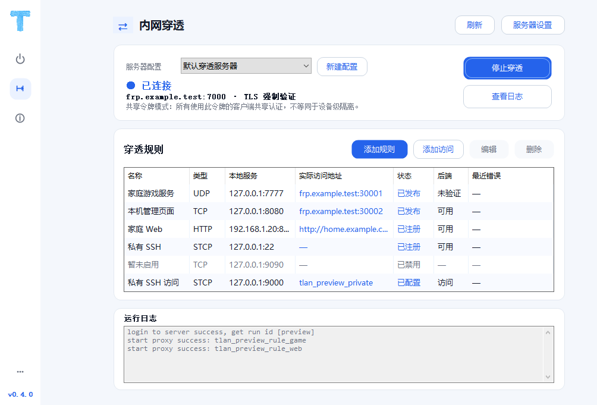

# TmkNetworkLAN 私人局域网

面向你自己的 Linux amd64 服务器（CentOS 7.9 / Debian / Ubuntu）和熟人使用的 Windows 10/11 amd64 客户端。Windows EXE 直接打开白蓝色原生窗口，界面采用 `frpc-desktop` 风格的左侧导航、页面标题、白色内容卡片和紧凑状态列表；首次加入后，启动状态和网络成员整合在同一个工作区。程序图标是手绘的淡亮蓝色刷痕 T，EXE、窗口、弹窗和应用内品牌图使用同一原图。

当前发布客户端已内置 `https://8.163.21.82:8443`；STUN 地址为 `8.163.21.82:3478`。控制、入网和中继直接使用 IP，普通用户界面不要求服务器地址或管理员令牌。旧域名版客户端保存的成员身份会迁移到这一固定 IP 地址，设备身份和虚拟 IP 保留。

## 发布文件

- `dist/TmkNetworkLAN-server-linux-amd64.run`：CentOS 7.9 / Debian / Ubuntu 单文件安装包，内置服务端和 Caddy；[安装说明](docs/INSTALL-LINUX.md)。
- `dist/TmkNetworkLAN-client-windows-amd64.zip`：Windows GUI、图标、官方 Wintun DLL 和许可证。
- `dist/TmkNetworkLAN-server-debian-amd64.zip`：Debian/Linux 独立二进制（首次启动生成 YAML 配置）、Caddy 和 systemd 配置。
- `dist/TmkNetworkLAN-frps-debian-amd64.tar.gz`：独立 FRPS v0.71.1、systemd unit、安装脚本、TLS/token 示例和 Apache-2.0 许可证。
- 可执行文件：`dist/windows/TmkNetworkLAN.exe` 和 `dist/linux/tmknetworklan-server`。

Windows 包需要完整解压，保留 EXE 同目录的 `wintun.dll`；双击会显示 UAC 提示，因为配置虚拟网卡和路由需要管理员权限。无需打开终端或浏览器。Linux 发布包不需要安装 Go、WireGuard 或桌面环境。

## 给熟人的使用方法

1. 完整解压客户端包，双击 `TmkNetworkLAN.exe`。
2. 首次打开显示入网令牌输入框、“加入网络”按钮和“配置内网穿透”入口。令牌默认隐藏，输入新字符时会短暂显示最后一位；点击输入框右侧的闭眼图标可切换为完整显示，再次点击恢复隐藏。加入成功后会加密保存本机成员凭据，下次打开跳过此页。电脑名称自动使用本机名称。
3. 加入后停留在“虚拟网卡组网”页。关闭状态保持居中的描边电源按钮；点击后开启虚拟网卡，电源显示蓝色圆环并移动到页面上方。
4. 启动后，同一页下方显示本机名称、分配的虚拟 IP，以及所有已加入设备的虚拟 IP、“在线 / 离线 / 连接中”、直连或中继路径和延迟。本机与在线设备优先排列，离线历史成员保留。
5. 点击上方电源按钮关闭转发，成员区收起并回到居中的启动状态；再次点击重新开启，沿用原有虚拟 IP。

关闭电源会关闭加密引擎并释放本程序创建的虚拟网卡、路由和防火墙规则，成员记录和 IP 保留。关闭整个客户端也会停止 Mesh 转发和受管内网穿透进程；下次打开会恢复成员身份，等待你手动开启电源。

延迟是经过实际 WireGuard 链路的往返探测值，直连和中继均可测量，不是到服务器的 Ping。尚未连通时显示“连接中”和 `—`，不会伪造延迟。服务端在线状态约每 5 秒同步；客户端异常退出时，服务器在最后心跳约 30 秒后标记离线。

左侧导航底部“···”菜单可更换入网令牌、退出当前网络或查看连接诊断；更换令牌和退出前需先关闭电源。连接诊断生成本地报告并上传私人服务器。错误提示显示中文原因、处理建议，并提供隐藏已知凭据后的技术详情。临时断网不会清除已保存的成员身份，也不会把已加入的用户送回首次加入页。

左侧“ⓘ”按钮打开版本信息窗口；电源按钮和“内网穿透”按钮分别管理两个独立功能。

界面动效包括：令牌输入框获得焦点时显示淡蓝色光晕；启动后成员区域从页面下方平滑滑入，关闭时向下收起；左侧导航切换时，蓝色选中背景以滑动方式过渡。

## 内网穿透（P2/P3 受控发布）



首次加入页提供“配置内网穿透”入口，不需要先加入 TLAN 虚拟网络。页面支持多个独立服务器配置，每个配置拥有自己的 token、CA、规则、访问器、运行目录和 `frpc` 进程。切换配置不会复用另一个服务器的凭据；各配置可以独立启动和停止。

当前数据面支持：

- TCP、UDP、HTTP、HTTPS、STCP、SUDP 代理规则，以及 STCP/SUDP visitor
- 本机回环、显式物理 LAN IPv4、TLAN 成员（`mesh_peer`）和本机 Mesh 地址（`mesh_self`）
- HTTP/HTTPS 自定义域名；visitor 只绑定 `127.0.0.1`
- 托管设备发布租约、端口/域名配额、冲突检查、续租和按设备撤销
- FRPS `Login`、`NewProxy`、`Ping`、`NewUserConn` 插件 fail-closed 校验
- 托管客户端每 5 秒续租；撤销或成员删除后，受管 frpc 与 TargetGateway 在 10 秒内停止
- TargetGateway TCP/UDP 会话隔离、generation/lease 失效检查、半关闭和诊断计数
- Mesh 目标按成员身份、虚拟 IPv4、WireGuard 公钥、service ID、管理员登记的服务授权和 generation 绑定，并通过虚拟接口发送
- 依赖失效时进入“等待组网恢复”状态，Mesh 恢复后自动重试；Mesh 规则要求独立配置，不能与独立 FRP 规则混在同一配置
- FRP 管理 API 的实际状态和地址；HTTP/HTTPS 显示实际注册地址，TCP/UDP 显示实际公网端口
- 服务器传输支持 TCP、WebSocket、WSS、KCP、QUIC；代理支持 TCPMUX、XTCP；HTTP 支持 locations、Basic Auth、subdomain、Header rewrite
- 目标成员发布申请与同意/拒绝/撤销流程，批准前不能签发 Mesh lease
- 批量 TCP/UDP 端口规则和受限 TLAN JSON 配置导入/导出
- 外部 FRPS 兼容档位可单独配置 `transport.tcpMux` 和 `transport.tls.disableCustomTLSFirstByte`，默认均开启且必须与服务端一致

安全与进程约束：

- TLS 强制启用，必须有可信 CA 和正确 `serverName`，没有跳过证书校验选项
- 服务器 token、规则/访问器私有密钥均由当前 Windows 用户 DPAPI 保护；FRP 秘密读取拒绝明文降级
- 运行时 token、管理密码和 capability 通过受保护文件/受限环境传递，日志做脱敏；运行目录使用当前用户 DACL
- 受管 `frpc.exe` 使用独立 Job Object、挂起创建、受限句柄列表和最小环境变量，并以 Medium 完整性、Administrators deny-only 的受限令牌运行
- FRPS TCP 控制连接经过只监听回环的认证出口代理；每次拨号重新查询系统路由，并用 Windows 接口约束拒绝 TLAN 路径。启动 Mesh 和运行中网络变化都会双向复检，证据不足时 fail-closed
- 不按进程名结束 FRP，不会误杀用户自行运行的 `frpc.exe`
- 关闭软件时停止全部受管配置并清理运行目录

内置核心固定为 FRP `v0.71.1`：Windows 包中的 `frpc.exe` SHA-256 为 `509f4fa082bf9b85f9ad27b45d37a89a8accb011f3b724cff352dfac90a94feb`，Linux `frps` 为 `2fb8da8392cf2b332bfcc540f075e928a82d1a106df0b8fcfcf13497149f8c48`。Mesh 开关和 FRP 开关互不依赖；关闭组网不会停止独立 FRP 配置，FRPC 故障也不会重建 Wintun。

仍需外部环境证明的边界：

- 本机真实 FRPS/FRPC 联调已覆盖 TCP/UDP、HTTP/HTTPS 高级字段、STCP/SUDP、TCPMUX、WebSocket、KCP、QUIC、visitor、托管高级授权、撤销 SLA 和 TargetGateway；WSS 已通过公网 Caddy 8444 managed 回显验证，并在双 FRPS 架构下完成 WSS TCP/HTTP/HTTPS/TCPMUX 组合验证；KCP、QUIC、主 FRPS TCPMUX 也已通过真实公网 managed 回归。XTCP 双端打洞仍需真实网络验收。
- 真实公网 FRPS 已完成 TCP、UDP 和 HTTP vhost 验证，包括 managed lease、Host/Header 往返、停止后端口/路由关闭和清理；详见 `docs/PUBLIC-MANAGED-FRP-VERIFICATION-2026-10-21.md`。尚未完成两台独立 Windows、真实 Debian 主机、物理 LAN 抓包、接口切换和 24–72 小时长稳验收。
- 托管模式要求 FRPS 实际启用 `httpPlugins` 的四个操作；客户端会在启动后读取控制面 lease status，确认 FRPS 已观察到 Login 和 proxy。该检查依赖控制面与 FRPS 的部署一致性，仍应按 `docs/FRPS-DEPLOY.md` 核对日志。
- P3 使用 TLAN 控制面签发的精确目标授权，跨成员发布需要目标成员在“目标授权”窗口逐次同意；拒绝、撤销或服务授权失效都会关闭相关转发。
- 当前 GUI manifest 要求管理员权限；受管 `frpc.exe` 已改为使用当前用户的 Medium 完整性受限令牌启动，管理员组 deny-only，预检失败时 fail-closed，不回退管理员令牌。
- QUIC/KCP/WebSocket/TCPMUX/XTCP 和高级 HTTP 已接入；任意插件、VirtualNet、原始 TOML、自定义核心、SYSTEM 服务、生产签名自动更新仍未开放。
- 已支持托盘、关闭到托盘、当前用户登录自启动和低权限 frpc；没有声称完整搬入 `frpc-desktop` 的全部功能。

FRPS 独立部署步骤见 [FRPS 独立部署说明](docs/FRPS-DEPLOY.md)。安装包不会修改现有 `tnlan-config.yml`、成员数据库、Caddy 配置或 TLAN 服务。

## Linux 一键安装

将 `dist/TmkNetworkLAN-server-linux-amd64.run` 上传至服务器，在文件所在目录执行：

```bash
sudo bash ./TmkNetworkLAN-server-linux-amd64.run
```

优先适配 CentOS 7.9，使用兼容 systemd 219 的服务文件及静态 amd64 二进制；同时支持 Debian/Ubuntu。默认 HTTPS 地址为 `https://8.163.21.82:8443`。阿里云安全组需放行 TCP 80、TCP 8443、TCP 8444、UDP 3478；如果部署独立 FRPS，还需按 FRPS 文档放行 TCP 7000、UDP 7002-7003、TCP 18080-18083、TCP 18443-18444 和 TCP/UDP 30000-30999。TCP 80 用于公网 IP 证书签发及续期。已有配置与成员数据会保留，程序更新前自动备份。已有独占本项目的 `caddy.service` 时可加 `--replace-caddy`，只检查可加 `--check`。详细条件和验证范围见 [安装说明](docs/INSTALL-LINUX.md)。

构建安装包：`./build-server-installer.ps1`；已缓存 Caddy 时可以加 `-Offline`。

## Linux 服务端：手工配置与运行

把 Linux 包上传并解压到服务器目录。程序只读取启动时当前目录下的 `tnlan-config.yml`，不再依赖环境变量。

```sh
chmod +x tmknetworklan-server
./tmknetworklan-server
```

第一次运行只生成 `tnlan-config.yml`，打印文件位置后正常退出，不创建监听端口或数据目录。检查并修改配置后再次运行：

```sh
./tmknetworklan-server
```

生成后的结构如下。两个令牌由程序使用系统随机源生成；`security.admin_token` 仅供你维护服务器，`network.join_code` 才分享给熟人。

```yaml
network:
  name: 我的私人网络
  cidr: 10.240.0.0/24
  join_code: 首次启动随机生成
server:
  listen: 127.0.0.1:8080
  stun_listen: :3478
  tls_cert: ""
  tls_key: ""
  relay_listen: ""
  relay_cert: ""
  relay_key: ""
storage:
  data_dir: ./data
security:
  admin_token: 首次启动随机生成
```

配置文件创建权限为 `0600`。加载时会严格检查字段名和取值范围：拼错字段、管理员令牌少于 24 字符、入网令牌不是 8–256 字节、非私人 IPv4 网段、TLS 证书与私钥不配对，都会阻止启动并指出具体字段。`storage.data_dir` 可使用相对当前工作目录的路径。

首次创建私人网络后，后续重启会保留网络、成员和虚拟 IP。修改 `network.join_code` 会更换新成员加入时使用的令牌，已签发的成员凭据仍有效；将其设为空字符串可禁止新成员加入。若当前目录已有旧版 `state.json`，首次生成配置会自动把 `data_dir` 设为 `.`，避免升级后产生空网络或重新分配 IP。

## IP、HTTPS 与端口

服务器公网 IP 为 `8.163.21.82`。发布包的 Caddyfile 使用 IP 站点和 Let's Encrypt 短期 IP 证书，已用 Caddy **2.11.7** 验证配置。部署和升级步骤见 [IP 部署说明](docs/IP-DEPLOYMENT.md)。

```caddyfile
{
    default_sni 8.163.21.82
}

https://8.163.21.82:8443 {
    tls {
        issuer acme {
            dir https://acme-v02.api.letsencrypt.org/directory
            profile shortlived
            disable_tlsalpn_challenge
        }
    }
    reverse_proxy 127.0.0.1:8080
}
```

Caddy 提供包含 IP SAN 的受信任 HTTPS 证书，并代理控制 API 与 HTTP/1.1 Upgrade 中继。IP 客户端不发送域名 SNI，`default_sni` 让位于云服务器 NAT 后的 Caddy 仍选择正确的公网 IP 证书。业务入口仍为 TCP 8443，TCP 80 用于 HTTP-01 验证和自动续期，不能在首次签发后关闭。请确保云防火墙和服务器防火墙允许所用端口：

| 用途 | 端口 |
| --- | --- |
| HTTPS 控制和中继 | TCP 8443 |
| WSS FRP 入口 | TCP 8444 |
| Caddy IP 证书验证和续期 | TCP 80 |
| STUN 获取公网 UDP 映射 | UDP 3478 |
| FRPS 控制（独立部署，TLS-only） | TCP 7000 |
| FRPS KCP / QUIC（独立部署） | UDP 7002 / 7003 |
| 主 FRPS HTTP / HTTPS vhost | TCP 18080 / 18443 |
| 主 FRPS TCPMUX | TCP 18081 |
| WSS FRPS HTTP / HTTPS vhost | TCP 18082 / 18444 |
| WSS FRPS TCPMUX | TCP 18083 |
| FRPS 业务端口（独立部署示例） | TCP/UDP 30000-30999 |
| WSS FRPS 回环回源 | TCP 7001，仅 127.0.0.1，不公网放行 |

客户端校验证书链、有效期和目标 IP，不提供跳过 TLS 校验的开关。普通域名证书不能用于这个 IP 地址；Caddy 自动申请和续期包含 `8.163.21.82` 的 IP 证书，不需要给客户端分发私有根证书。HTTPS 入网口令和成员凭据继续加密传输。

使用 Caddy 时，YAML 保持 `server.listen: 127.0.0.1:8080`，`server.tls_cert` 和 `server.tls_key` 留空。如果自行管理受信任的 IP 证书，也可同时设置这两个字段，并把 `server.listen` 改为 `:8443`，由 Go 直接提供 HTTPS，此时证书更新后需重启后端，且不能再让 Caddy 占用同一端口。服务端本身不创建虚拟网卡，普通高端口运行无需 root 或 `CAP_NET_ADMIN`。

## systemd

将新二进制放在 `/opt/tmknetworklan/tmknetworklan-server`。发布包的 `tmknetworklan.service` 使用原来的 `lanmesh` 服务账户和 `/var/lib/lanmesh` 状态目录，并以该目录作为工作目录；配置文件位于 `/var/lib/lanmesh/tnlan-config.yml`。已有旧服务升级时先停止旧 unit，再启动新 unit，避免两个进程同时监听端口。

```sh
sudo systemctl daemon-reload
sudo systemctl start tmknetworklan
# 第一次只会生成 /var/lib/lanmesh/tnlan-config.yml 并退出
sudo nano /var/lib/lanmesh/tnlan-config.yml
sudo systemctl start tmknetworklan
sudo systemctl enable tmknetworklan
sudo journalctl -u tmknetworklan -f
```

## 入网与成员凭据

客户端只内置公开服务地址，不内置管理员令牌和共享入网口令。匿名入网接口校验口令并限制尝试频率；加入后签发仅限本机、本网络的成员凭据。凭据响应使用设备已有 X25519 密钥、HKDF 和 ChaCha20-Poly1305 封装，只有持有对应设备私钥的客户端能够读取。

服务器保存入网口令的 PBKDF2-SHA256 验证值和成员凭据的哈希，不保存客户端私钥。普通成员不能创建网络、操作其他设备的心跳或电源、删除其他成员，也不能以其他设备身份连接 HTTPS 中继。管理员 API 仍使用单独的管理令牌。

Windows 私钥与保存的成员凭据由当前用户的 DPAPI 保护。已有 LANMesh 安装继续使用 `%APPDATA%/LANMesh/`，以保留设备身份、IP 和成员令牌；全新安装使用 `%APPDATA%/TmkNetworkLAN/`。入网口令不保存。移除成员会删除对应成员凭据；持有共享入网口令的设备仍可重新申请加入，永久封禁另属后续管理功能。

## 数据通道与边界

WireGuard 加密 IPv4 包；UDP 直连探测、STUN 与 WireGuard 共用同一个 UDP socket；直连不可用时通过 HTTP/HTTPS Upgrade 中继转发密文。中继有会话、队列、连接数量和超时限制。服务端是成员及公钥分发的信任中心。

Windows 使用 Wintun 三层网卡，IPv4 包通过额外信封保持原始广播/组播目的地址。支持单播、限制广播、子网广播与 IPv4 组播；广播每秒最多 100 包，每包最多复制给 64 个成员。单网络成员上限 128；一个客户端一次连接一个网络。当前不是任意 Ethernet 二层桥，不提供 IPv6，也不使用 Radmin 私有协议。

默认 MTU 1280；虚拟网段只能来自 `10.0.0.0/8` 或 `100.64.0.0/10`，并拒绝与已有活动接口重叠。不会修改默认网关或 DNS。为虚拟接口配置广播/组播路由和限定接口的防火墙规则，关闭时释放。

未测试 Dark Hours，未实现完整的游戏专用诊断与配置模块。普通组网不能保证修复 Steam/EOS 服务或游戏自身故障。其他功能差距见 FEATURE-AUDIT.md。

## 从源码构建

需要 Go 1.23.1 或以上版本，依赖已 vendored：

```powershell
.\build-windows-client.ps1
.\build-debian-server.ps1
```

更换以后发给朋友的客户端地址时，由你重新构建：

```powershell
.\build-windows-client.ps1 -ServerURL 'https://8.163.21.82:8443' -STUNAddress '8.163.21.82:3478'
```

Windows 构建使用 GUI 子系统、TmkNetworkLAN 图标和 Common Controls v6 manifest，避免 `TTM_ADDTOOL failed`。构建脚本会校验 Wintun 和固定 FRP 核心的 SHA-256，任一不匹配都会拒绝打包。Wintun 与 FRP 来源、哈希及许可证见 THIRD-PARTY-NOTICES.md。

完整工具链、固定来源/摘要、构建参数、测试分层和 FRPC 能力边界见 [R0 构建与测试基线](docs/R0-BUILD-AND-TEST-BASELINE.md)；审查修复见 [R1/R2 实现与验证报告](docs/R1-R2-IMPLEMENTATION-REPORT-2026-10-21.md)，高级能力见 [高级功能实现与验证报告](docs/ADVANCED-FEATURES-IMPLEMENTATION-2026-10-21.md)。两平台基线可先运行：

```powershell
.\scripts\verify-build-baseline.ps1
```

```sh
go test -mod=vendor ./...
go vet -mod=vendor ./...
```

测试包含真实 wireguard-go 实例经本机 UDP / HTTPS 中继传输、成员凭据权限隔离、凭据加密、防伪造、端到端延迟及启停保持地址。OS 网卡使用内存替身，不代表完成两台实机的公网验收。

FRP 本机真实联调会启动临时 FRPS/FRPC、生成临时 CA 和服务器证书，验证 TCP/UDP、HTTP/HTTPS vhost、STCP/SUDP 访问器、错误 CA、错误 token、受管子进程终止和运行目录清理：

```powershell
$env:TLAN_FRP_INTEGRATION='1'
$env:TLAN_FRPS_BINARY=(Resolve-Path '.tmp-runtime\frps-v0.71.1.exe').Path
go test -mod=vendor ./internal/frp -run TestLiveFRPTCPUDP -v
```

该测试仅代表本机回环联调，不代表公网防火墙、Debian 主机或 24-72 小时长稳验收已经完成。


开发者可运行 `TmkNetworkLAN.exe --ui-smoke-test 报告绝对路径` 验证原生控件初始化，不创建网卡；`--adapter-smoke-test` 则显式创建并清理测试 Wintun 网卡。`--server`、`--stun` 和 `--identity` 参数用于开发调试，普通用户不需要使用。


