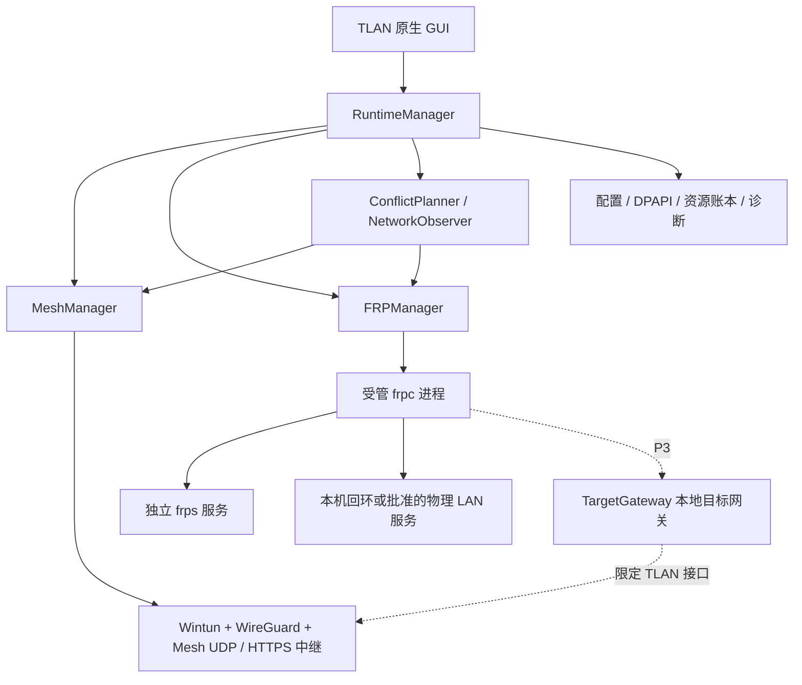

# TLAN 内置 FRPC 完整开发方案

编写日期：2026-10-18。适用项目：当前目录中的 TLAN（本文简称 TLAN），Windows 10/11 amd64 客户端、Debian amd64 服务端。

文档性质：基于现有源码和 FRP 官方资料的设计提案；本文新增模块、接口、配置和验收指标均为待开发内容，不代表已经实现或通过测试。此次只输出方案，不修改运行中的网络、服务器或现有业务代码。

实现状态（2026-10-21）：P1/P2/P3 主体已按本文落地并通过本机真实 FRP 联调；P4 的服务化、额外传输、低权限 worker 和真实公网/双机/长稳验收仍未完成。具体证据见 README、VALIDATION.md、docs/FRP-P2-P3-AUDIT.md 和 docs/FRPC-DESKTOP-COVERAGE.md。

## 1. 建议决策

采用 **TLAN 统一界面和管理器 + 独立受管 frpc 子进程 + 独立 frps 服务**。现有 Wintun/WireGuard 继续负责虚拟局域网，frpc 负责发布指定 TCP/UDP 服务。两者共享产品入口、诊断和授权管理，不共享底层 socket、网卡句柄、控制协议或启停上下文。

“内置”定义为：安装包自带经过校验的 FRP 核心，TLAN 自动配置、启动、停止、监控和升级，用户无需自行下载、打开终端或编辑 TOML。磁盘上允许存在独立 frpc.exe；是否只有一个分发 EXE 是打包问题，不应决定运行时是否隔离进程。

建议固定以下产品规则：

1. 虚拟网卡组网、FRP 穿透各有独立开关；关闭组网不影响指向本机回环或独立物理 LAN 的 FRP 映射。
2. 唯一允许创建 TLAN 虚拟网卡、配置组网路由的部件是 Mesh 管理器。内置 FRPC 禁止 VirtualNet 及其相关插件。
3. FRPC 到 FRPS 的连接默认走操作系统选出的非 TLAN 路径；禁止依赖 TLAN 自身虚拟网络或 TLAN 所管理的转发入口。
4. 第一阶段只发布本机回环服务，随后开放显式配置的物理 LAN；把 TLAN 成员服务发布出去另设高级功能，必须有独立授权、目标约束和依赖暂停机制。
5. 不把 FRP 当作现有 Mesh 中继的替代，也不让 FRP 自动“优化游戏”。同一业务默认选择虚拟 LAN 或端口穿透中的一种访问方式。
6. 不把管理员令牌、入网口令、成员令牌直接作为 FRP token；托管 FRP 的身份和资源权限单独设计。
7. 保留已存在的身份目录兼容性和虚拟 IP，不为了增加 FRP 重新入网、换钥或重新分配地址。

## 2. 已有资料与源码结论

已阅读 README.md、FEATURE-AUDIT.md、VALIDATION.md、go.mod，以及下列实际运行链路。历史文档有部分旧描述，冲突处以源码为依据。例如 FEATURE-AUDIT 的个别段落仍描述“所有 API 共用管理员令牌”，但当前 server.go 已支持成员凭据权限分支；VALIDATION 中部分早期服务 URL 没写 8443，当前构建脚本默认包含 8443。

| 当前事实 | 源码位置/符号 | 对内置 FRP 的影响 |
| --- | --- | --- |
| Windows GUI 直接持有一个 mesh.Engine | cmd/client/desktop_windows.go：desktop、startPower、stopPower | 需要上移独立运行管理层，不能在 mesh.Start 内附带启动 frpc |
| 关闭窗口取消根上下文并关闭引擎 | 同文件 runDesktop | 第一阶段仍保持“退出软件停止全部”；托盘/服务常驻必须显式开发 |
| GUI manifest 要求管理员权限 | cmd/client/TLAN.exe.manifest | 普通 exec 启动的 frpc 继承高权限，不会自动降权 |
| Wintun 是 L3 IPv4；默认 MTU 1280 | internal/platform/tunnel_windows.go、internal/mesh/packet.go | 不等于完整二层桥；FRP UDP 不能补齐广播发现和任意以太帧 |
| 配置虚拟地址，不设置网关；虚拟接口 metric=5 | platform.openTunnel | 普通公网 FRP 流量不会仅因 metric 小就进入虚拟网卡；仍需按目的地址核验路由 |
| 添加 255.255.255.255/32、224.0.0.0/4 路由 | 同上 | 广播/组播存在已有接口选择影响，不能用 FRP 再复制一次 |
| 网段冲突检查只枚举活动接口地址 | internal/platform/tunnel.go：OpenTunnel | 未覆盖静态路由、第三方 VPN 分流、关机时预配置的 FRP LAN 目标 |
| WireGuard/STUN/直连探测复用 Mesh UDP socket | internal/mesh/bind.go：Open、probeSTUN | 保持原样；FRP 不得接管这个端口或复用其 socket |
| 候选地址采集排除本 Mesh 前缀，但未全面分类其他虚拟网卡 | internal/mesh/engine.go：gatherCandidates | 不要把“非本 TLAN 网卡”一概称为物理接口 |
| Mesh 控制 API 已显式 Proxy=nil，中继直接 Dial | internal/clientapi/client.go：New；internal/network/relay_client.go | 保留独立 HTTP Transport，不让 FRP 代理/DNS 设置污染 Mesh |
| Mesh 心跳与组网引擎生命周期绑定 | internal/mesh/engine.go：controlLoop | 新增 FRP 在线状态必须独立，不能用 FRP 活跃表示虚拟网卡在线 |
| 当前网卡入站规则允许虚拟网段到本接口；ACL 库未接入 Mesh 数据面 | platform/tunnel_windows.go、internal/network/acl.go、internal/mesh/tunnel.go | 不能宣称现有 ACL 已能限制“公开哪些成员端口” |
| Windows 凭据用当前用户 DPAPI | internal/clientidentity/settings.go、secret_windows.go | 后续 SYSTEM 服务不能直接沿用当前用户解密上下文 |
| 网卡 Close 忽略 cleanup 的错误 | internal/platform/tunnel.go：IPTunnel.Close | 内置双引擎前需补资源账本、清理报告与残留检测 |
| go.mod 声明 Go 1.23.1，依赖 vendored | go.mod、build-windows-client.ps1 | 把新版 FRP 直接导入主模块会扩大工具链及依赖升级范围 |

源码的相对路径用于仓库内定位；上述结论来自本次静态阅读。既有验证记录表明本机有 Wintun 与加密链路测试，但仍没有跨公网双 Windows、真实 Debian 完整验收，不能据此承诺组合后的公网表现。

## 3. FRP 版本与集成方式

### 3.1 版本基线

本次查询的官方发布页显示 v0.71.1（2026-10-14），该版本源码要求 Go 1.26.0 或更新。建议将它作为**待验证的固定候选基线**，构建时记录版本、平台、SHA-256、来源和许可证；不要构建时自动拉取 latest。先服务端后客户端升级，并进行组合兼容验证。[官方发布记录](https://github.com/fatedier/frp/releases/tag/v0.71.1)、[固定版本 go.mod](https://raw.githubusercontent.com/fatedier/frp/v0.71.1/go.mod)。

FRP 官网配置页面可能对应较早版本；开发时以固定 tag 的结构定义、完整配置示例和真实二进制行为为准。TLAN 应记录“已验证能力表”，而不是只比较版本号。

### 3.2 方案比较

| 方式 | 好处 | 代价/风险 | 建议 |
| --- | --- | --- | --- |
| 内置官方 frpc.exe，受管子进程 | 故障、依赖和升级独立；官方兼容性好 | 需要配置文件、进程监管和版本化管理 API 适配 | 第一阶段采用 |
| 独立 tlan-frpc-worker.exe，在单独 Go 模块中引用 FRP | 可通过命名管道传配置、做严格拨号策略和结构化事件 | 需要维护很薄的适配层，跟随上游 API 变化 | 高级联动或更强隔离时采用 |
| 直接把 FRP Go 包导入当前 GUI 进程 | 可直接调用接口，少一个进程 | 全局状态、panic、依赖及高权限耦合；升级牵动 GUI/Mesh | 不推荐作为主路线 |
| 自行实现 FRP 协议 | 完全自主 | 兼容、认证、传输和维护成本高 | 不采用 |

选择进程隔离有具体源码依据：固定版本 client/service.go 的 init 会设置进程环境变量；Run 可设置默认 DNS；ServiceOptions 依赖 ConfigSourceAggregator，不能照搬旧文章中的 NewService 调用。它有 ConnectorCreator 扩展，但这只是连 FRPS 的连接边界，不等于所有 backend/visitor/UDP/STUN 拨号都会被同一 hook 覆盖。[FRP Service 源码](https://raw.githubusercontent.com/fatedier/frp/v0.71.1/client/service.go)。

### 3.3 能力范围

| 能力 | 交付阶段 | 约束 |
| --- | --- | --- |
| TCP、UDP 映射到 127.0.0.1 | P1 | 默认路径，普通用户最容易理解 |
| TCP、UDP 映射到物理 LAN 指定 IPv4 | P2 | 显式选择目标，启动和网络变化时重验路由 |
| HTTP/HTTPS、自定义域名 | P2 | 补齐域名授权、证书模式和服务器 vhost 配置 |
| STCP/SUDP + visitor | P2 | visitor 默认仅绑定 127.0.0.1；访问者也需相应客户端 |
| 映射 TLAN 自身虚拟地址或其他成员 | P3 | 必须经目标网关、成员授权和依赖状态机 |
| XTCP、QUIC、KCP、WSS | P4 | 各自验证穿透与出口策略；不默认开启 |
| VirtualNet、virtual_net 插件 | 所有阶段禁用 | 虚拟组网只有 TLAN 一个所有者 |
| 任意客户端插件、外部 includes、模板执行、任意二进制替换 | 默认不开放 | 高级导入也要归一化校验，不能直接透传 |

普通 UDP 映射并不要求 FRPC 到 FRPS 使用 QUIC/KCP；“代理业务类型”和“FRP 传输协议”是两个维度。XTCP 的打洞也不是 TLAN 的 WireGuard 打洞，二者不得互相复用状态。

## 4. 目标架构与流量模型



### 4.1 模式 A：两个功能独立，推荐默认

```text
组网：应用 → 虚拟 IP → Wintun → WireGuard → UDP 直连或 TLAN 密文中继 → 对端
穿透：公网访问者 → frps:remotePort → FRP 通道 → frpc → 127.0.0.1:localPort
```

两条路径只共享 CPU、物理网络及可能同一台服务器的容量；不共享虚拟地址或网卡。FRP 后端若为回环，甚至不经过 Wintun。

### 4.2 模式 B：发布物理 LAN 服务

```text
公网访问者 → frps → frpc → 192.168.50.10:8080
```

显式标记 target.kind=lan。即使某个地址形式上是内网地址，也不能自动判定为物理 LAN；须查询实际路由并排除当前/计划中的 TLAN 网段。第三方 VPN 路径由用户明确选择，不自动改路由绕开。

### 4.3 模式 C：发布 TLAN 成员服务，高级联动

```text
公网访问者 → frps → A 上的 frpc → A 的 TargetGateway
           → A 的 Wintun/WireGuard → B 的虚拟 IP:服务端口
```

这是应用层中转，不要求开启 Windows IP forwarding/ICS/NAT，不增加子网路由。B 的应用通常看到 A 的虚拟 IP，无法直接把公网来访者 IP 当作源地址。优先在实际提供服务的 B 上直接运行 frpc，可少一段链路和一个故障点。

### 4.4 明确排除的自依赖

```text
TLAN 中继 → 本机 FRP 映射入口 → 依赖 TLAN 的 frpc → TLAN 中继
FRPC serverAddr → TLAN 虚拟成员地址 → 需要先建立 TLAN 的通道
FRPC backend → 自己或另一个托管映射的公网入口 → 同一 backend
```

前两类属于基础传输依赖环，直接拒绝。第三类需在所有托管规则中做图检查；对未知外部 NAT、反向代理和域名跳转无法静态证明无环，仍需连接数上限、速率限制和故障熔断，不能声称“检查一次即可杜绝所有回环”。

## 5. 冲突处理：责任边界与强制规则

### 5.1 资源归属

| 资源 | 唯一管理者 | FRP 行为 |
| --- | --- | --- |
| Wintun、虚拟地址、Mesh 路由 | MeshManager / platform | 不创建、不修改、不删除 |
| 广播/组播转发 | Mesh 引擎 | 不再桥接、复制或导入相同发现流量 |
| Mesh UDP/STUN socket | meshBind | 不共用端口、不改绑定参数 |
| FRP 控制/工作连接 | FRP worker | 使用独立普通 socket |
| 本机 visitor、管理 API、TargetGateway 监听 | PortRegistry + 各资源所有者 | 显式申请并保留实际监听句柄 |
| 服务端 remotePort、域名 | FRPS + 服务端授权分配器 | 实际注册结果才算占用成功 |
| 系统默认路由/DNS/代理 | 操作系统与用户原配置 | 内置 FRP 不修改 |
| 凭据 | SecretStore | 每种用途分开，不互相复用 |

所有配置变更先通过 ConflictPlanner，运行时由各管理器再次校验，不能只在 GUI 表单层拦截。

### 5.2 VirtualNet 与网卡冲突

FRP 官方将 VirtualNet 标为 Alpha，并描述通过 TUN 和路由实现网络层互联；该文档列出的平台是 Linux/macOS。因此，不能宣称当前 Windows 版必然会创建第二块 Wintun，但跨平台和未来升级仍应在策略层禁止这项功能。[官方 VirtualNet 文档](https://gofrp.org/en/docs/features/common/virtualnet/)。

具体阻断项：

- featureGates.VirtualNet=true。
- 任何 virtualNet 配置块，即使 feature gate 暂时为 false。
- proxies.plugin.type 或 visitors.plugin.type 为 virtual_net。
- 通过 includes、Store API、模板、环境展开或配置导入重新引入以上字段。
- 未经能力表明确接受的新 feature gate 和插件。

普通模式只生成自有模型对应的字段，不允许把原始 TOML 直接交给 frpc。导入时给出字段级错误；不能悄悄删掉用户配置后显示“完全导入成功”。

### 5.3 路由、出口与网段重叠

当前 TLAN 没有默认路由，正常公网地址不会被 10.240.0.0/24 捕获。路由选择应先考虑目的前缀匹配，再考虑相关 metric；不能把“虚拟网卡 metric=5”解释为“所有流量优先走 TLAN”。真正风险是目标地址重叠、第三方 VPN 路由和接口切换。

新增 NetworkObserver：

1. 枚举接口、IPv4 地址、接口状态、路由和本产品所有虚拟网络；区分 loopback、TLAN、其他 VPN、普通上联网卡。
2. 对 frps、TLAN 控制/中继/STUN、LAN backend 的实际目标地址调用 GetBestRoute2，记录接口 LUID/索引、源地址、前缀和下一跳。
3. 启动前做规划，网卡建立后做复核，网络/地址/路由变化后重新协调；检查与连接之间存在竞态，需连接约束配合。
4. 不缓存接口索引跨重建使用；索引会改变，每次结合接口标识和 engineGeneration 验证。[GetBestRoute2 文档](https://learn.microsoft.com/en-us/windows/win32/api/netioapi/nf-netioapi-getbestroute2)。

规则示例：

| 场景 | 动作 |
| --- | --- |
| FRPS 公网 IP 的有效路由为 TLAN | 阻止 FRP 启动，提示“穿透服务器依赖虚拟网络” |
| serverAddr 解析出 TLAN 虚拟 IP | 普通服务器配置拒绝，不自动增加绕行路由 |
| LAN 目标落在计划启用的 TLAN CIDR | 启动 Mesh 前提示冲突并阻止该组合；保留已经正常工作的实例 |
| 现有静态/VPN 特定路由与 TLAN 前缀相交 | 分析覆盖范围并阻止会改变受管业务路径的启动；默认路由相交不算网段冲突 |
| 第三方 VPN 默认路由接管公网 | 尊重系统选路；显示经其他 VPN，不擅自添加公网 /32 绕过 |
| Wi-Fi 切到有线，原绑定源 IP 消失 | 使旧 generation 失效，暂停受影响实例，重选出口后重连 |
| 物理网络临时不可用 | 指数退避；不创建新的虚拟网卡补救 |

默认策略命名为 non_tlan_system_route，即“系统选择的非 TLAN 路径”，不能命名 physical_only 后又允许其他 VPN。显式指定上联网卡属于高级策略。

v0.71.1 的普通连接路径支持 connectServerLocalIP，但 QUIC 分支走独立的 DialAddr 路径；绑定源 IP 也不等于覆盖全部传输、DNS 和 backend 拨号。[FRP Connector 源码](https://raw.githubusercontent.com/fatedier/frp/v0.71.1/client/connector.go)。第一阶段只启用 TCP+TLS，并验证真实出口。以后要承诺硬性接口隔离，使用独立 worker 的受控 Connector 和 Windows socket 接口约束，逐一覆盖实际拨号点；不能单靠一个 TOML 字段承诺“绝不走虚拟网卡”。

默认不加 FRPS 的 /32 静态路由。若企业环境明确需要固定出口，必须由单独 RouteLease 记录目标、接口、下一跳、所有者和引用计数；DNS 变化时更新，停止时只回收自己的条目。不得删除外部 VPN 原有路由。

### 5.4 端口冲突：必须区分三类端口

普通 TCP/UDP proxy 的 localPort 是 frpc 要连接的后端端口，通常不是 frpc 自己监听的端口。游戏监听 7777、frpc 的 localPort=7777 是正常配置；只有 visitor、管理服务、插件或目标网关实际 listen 同一个冲突地址时才会抢占。

| 类型 | 所在位置 | 检查方法 |
| --- | --- | --- |
| localIP/localPort | 客户端后端服务 | 检查服务可达/监听地址；不要提前 bind 占住应用端口 |
| visitor.bindAddr/bindPort、webServer、目标网关端口 | 客户端监听 | 地址族+协议+绑定范围+端口联合检查，并以真实 bind 为准 |
| remotePort、vhost 端口 | FRPS 服务器 | 服务端保留资源、注册确认；本机 netstat 没有判定能力 |

PortRegistry 必须识别 0.0.0.0 与具体 IPv4 监听的覆盖关系、IPv6 dual stack 与 IPv4-mapped 地址、TCP/UDP 区别、排除端口范围和 HTTP.sys 等占用情况。预检查只改善提示，真实 bind 失败仍要处理，不能用“先 listen 再 close”消除竞态。

现有客户端 Mesh UDP 常用动态端口；服务端 STUN 的 UDP 3478 与另一个主机上的客户端端口不是同一资源。TCP 3478 和 UDP 3478 也不因数字相同就必然冲突。

公网端口分配建议使用 serverID + bindAddress + protocol + port 唯一键，事务状态 reserved → registering → active → releasing。一个游戏需要同号 TCP/UDP 时，作为一个资源组分配；任一协议注册失败，整组回滚或明确显示部分可用，不随机换号。

### 5.5 防火墙和公开范围

保留现有 Mesh 规则的虚拟接口范围；增加 FRP 不应把规则改成“所有接口/所有来源/所有端口”。FRPC 主动连接 FRPS，后端为回环时通常无需新增物理网卡入站规则。visitor 默认只绑定 127.0.0.1，不自动开放给局域网或 TLAN 成员。

如果用户需要把 visitor 绑定到自己的 TLAN 虚拟 IP，应将它分类为 mesh-dependent listener：网卡就绪后绑定，网卡关闭前撤销监听，不回退 0.0.0.0。外部监听需逐条声明绑定地址、协议和来源范围。

注意：现有 Mesh 规则本身允许同网段成员访问虚拟接口，新增一个更窄的 Allow 规则不会覆盖已有宽 Allow。若要提供逐端口限制，应改造现有宽规则或实现真正的数据面 ACL，不能只“再添加一条允许规则”就宣称完成隔离。

所有新规则带产品、组件、实例 ID；由 ResourceLedger 精确创建和删除。不能用通配符删除所有包含 TLAN/LANMesh 的规则，也不能删除用户已有配置。

### 5.6 广播、游戏发现、MTU 与源地址

- FRP 只发布指定服务；不把 255.255.255.255、组播地址或虚拟子网广播当作 backend。
- 不开启 ICS、网桥或默认 IP 转发。游戏发现继续由当前 Mesh 的 IPv4 广播/组播机制负责。
- 既有 224.0.0.0/4 低 metric 路由可能影响多网卡应用的组播选择，这是已有设计风险。后续可做按游戏/组播组缩小范围的策略，但不能为了 FRP 一次性删除原有广播能力。
- 同一游戏同时收到虚拟 LAN 发现结果与 FRP 公网入口时，可能出现重复房间、选错地址、源地址识别变化；UI 应明确推荐一个访问入口。FRP 不保证解决 Steam/EOS 或 SampleGame 自身问题。
- FRP 到回环时不受 Wintun 1280 MTU 限制；到 TLAN 对端时，后端 TCP 由 OS 按路径处理，UDP 必须测试。IPv4 无选项时，1280 MTU 对应 UDP payload 上界 1252 字节；这是内层不分片预算，不是完整互联网路径的保证。
- FRP 的 udpPacketSize 与 Mesh MTU 是两个不同参数，不能一键都改成 1500 或 1280。记录超大报文、丢包、重组失败，按目标模式和实际传输测试；保守游戏模板可从 1200 字节应用数据开始验证。
- 普通代理通常改变后端看到的来源；只有服务明确支持时才开启 PROXY protocol。向普通游戏端口强插 PROXY 头会破坏协议。

## 6. 高级联动：把 TLAN 成员服务作为 FRP 后端

这是两个部件最容易产生实际冲突的模式。不能只允许用户把 localIP 填成 10.240.0.20，然后把失败全部解释成“FRP 连接失败”。建议 P3 单独实现。

### 6.1 目标必须绑定身份

保存 networkID + deviceID + serviceID/协议/端口 + grantID，运行时由当前成员列表解析虚拟 IP。不要只保存一个裸虚拟 IP，因为成员删除、换网络或将来地址复用后，相同 IP 可能属于不同设备。

发布者为 A、服务所属设备为 B 时，控制面授权至少绑定：A、B、网络、协议、端口、FRPS/公网入口、有效期、授权版本和撤销状态。第一版可由管理员管理授权，后续再增加 B 的设备确认；不能把“持有入网令牌”当作“允许公开其他成员服务”。

权限的现实边界：当前私有 Mesh 允许成员互访，一个完全控制自己电脑的恶意成员仍可能用外部代理软件转发其可访问的服务。TLAN 的发布授权能约束**受管 FRP 功能**，不能凭客户端表单阻止所有再分享。若要求强防转发，需服务自身鉴权、缩小 Mesh 访问权限和目标端策略共同实现；这是额外安全边界。

### 6.2 TargetGateway：把目标约束集中在一处

为每条受管 Mesh 发布规则分配一个仅本机回环监听的目标网关。frpc 只连接该回环端口，网关负责连接真实目标。普通 localhost 模式不需要额外经过网关。

TCP 网关要求：

1. 只允许该规则固定的协议、设备和端口，不接受客户端提供任意目标。
2. 每次新连接读取最新授权、成员公钥/IP、Mesh generation 和路线快照。
3. 绑定当前 TLAN 虚拟源 IP，设置对应出口接口，要求目标路由匹配 TLAN 接口；任一条件不满足立即拒绝。
4. Mesh 停止、授权撤销或目标身份变化时，立即关闭网关到 backend 的现有连接并拒绝新连接，然后撤销 FRP 对外注册。
5. 连接、读写、空闲和关闭均设置界限，记录双向字节和终止原因。

UDP 网关还必须维护按来源分离的会话映射、后端独立 socket、回复归属、空闲 TTL、会话上限和 payload 上限；不能所有访问者共享一个无区分 UDP socket，否则游戏会串会话。停网卡或撤销时删除全部会话，不能让 OS 改走新的物理默认路由继续发包。

mesh_self 需单独处理：连接本机自己的虚拟 IP 可能由 Windows 本地路由交付，不一定真正经过 Wintun 出口。此时验证该虚拟地址仍属于当前 Mesh 实例、网卡与 generation 有效，并监听依赖撤销；不能机械要求 GetBestRoute2 一定返回对端模式的出口。能让服务监听 127.0.0.1 时优先使用普通 loopback 规则，只有确实绑定虚拟地址的服务才使用 mesh_self。

Windows 的 IP_UNICAST_IF 可指定 IPv4 出口接口，其设置值有网络字节序要求；实现时以专门的 platform 单元封装，配合源地址绑定、连接代际检查和接口变更取消。[微软 socket 选项文档](https://learn.microsoft.com/en-us/windows/win32/winsock/ipproto-ip-socket-options)。必须在接口删除、索引重用和第三方 VPN 切换场景实测。若上述约束不能证明无回退，增加 WFP 等系统级出口策略或不开放此模式，不能靠定时轮询冒充无泄漏保证。

回环监听不是对本机其他进程的认证边界。普通 TCP gateway 无法仅凭来自 127.0.0.1 就证明调用者是 frpc；最低保证是目标固定且不会扩大本机现有访问范围。需要防止其他本机用户借网关跨权限访问时，采用独立 worker 的命名管道/认证封装或进程级系统策略；不把随机端口视为认证。

### 6.3 双重中继与性能

在 Mesh 使用中继时，模式 C 可能变成：公网访问者 → FRPS → A → TLAN 中继 → B。即使 FRPS 与 TLAN 中继在同一 VPS，也会产生多段传输和额外流量；发生丢包时可能叠加可靠传输的排队影响。

UI 显示“FRP → TLAN 直连”或“FRP → TLAN 中继”，统计分别显示 FRP 应用字节、Mesh 内部/加密字节和服务器流量，不能简单相加后称为唯一业务流量。为后台文件传输设置限速，给游戏留出实际可用带宽；DSCP 标记不能保证运营商优先级。

## 7. 生命周期、状态机与故障隔离

### 7.1 上下文结构

```text
AppRoot
  ├─ MeshSessionContext（每次开关重新生成）
  ├─ FRPProfileContext[独立模式实例]
  ├─ FRPProfileContext[Mesh 依赖实例]
  └─ Observer / Diagnostics / ResourceLedger
```

FRP 不挂在 MeshSessionContext 下；两者由 RuntimeManager 协调依赖。Go 侧每个资源有 owner、generation、done channel 和明确 Close 顺序；Stop 只改变目标状态，统一 reconcile 执行，不让多个 UI goroutine 同时操作同一实例。

主窗口全局 busy 改为组件级操作状态；Mesh 正在启停时不能使无关 FRP 配置全部不可编辑。所有后台结果带 generation，旧任务返回不能把已停止的实例重新标为在线。

### 7.2 进程分组

第一阶段不要把所有 FRP 规则放进一个大 frpc 进程。按 serverProfile + credentialScope + dependencyDomain 分组：

- independent：回环/独立 LAN 规则；
- mesh:<networkID>：依赖某虚拟网络的规则；
- 必须单独撤销或要求严格故障隔离的规则可独立成组。

每组一个 frpc 管理端口和配置文件，限定实例总数并通过性能测试确定上限。代理名用设备/规则稳定 ID 生成；同一 FRPS 上不同组的名称不能重复。UI 显示友好名称，内部资源名不随重命名改变。

这样第一版通过重启某组应用配置时，不会断掉另一组的映射。后续引入经过验证的热更新/API 适配减少组内中断，但不要提前宣称变更零掉线。

### 7.3 状态模型

Mesh：Stopped → Starting → Running/Degraded → Stopping → Stopped，另有 Failed。

FRP 实例：Stopped → Validating → Starting → Authenticating → Running/Degraded → Stopping；错误重试进入 Backoff；凭据/配置错误进入 Blocked，等待修正。

FRP 规则单独保存：Disabled、WaitingDependency、Registering、Published、BackendUnavailable、Rejected、Suspended、Revoked。Published 表示服务器确认注册；BackendUnavailable 可与 published=true 同时存在。不要把复杂状态压成一个“在线”。

四层事实分别展示：进程存在、控制连接认证成功、proxy 已注册、backend 可用。公网实际可达还需要外部探测；仅前三项通过不能显示“公网访问已验证”。UDP 无通用无副作用的健康探测，默认显示“未验证”，仅对有明确探测协议的服务发探测包。

### 7.4 启停矩阵

| 操作/事件 | Mesh | 独立 FRP | Mesh 依赖 FRP |
| --- | --- | --- | --- |
| 开组网 | 创建/复用身份并启动 | 保持 | 用户预先选择自动恢复时，在依赖和授权成立后启动 |
| 关组网 | 按顺序关闭 | 保持 | 先禁止后端访问、撤销发布，再关网卡；目标保持“启用但等待组网” |
| 关某个 FRP 配置 | 保持 | 仅关目标实例 | 不自动关闭 Mesh |
| FRP 崩溃或 FRPS 故障 | 保持 | 该组退避恢复 | 该组恢复，仍检查 Mesh 条件 |
| Mesh 崩溃/被踢/网卡消失 | 故障或停止 | 保持 | 立即切断网关，暂停规则，不等待 FRPS 心跳超时 |
| 更换/退出 TLAN 网络 | 依现有规则先停止 | 外部独立配置可保留 | 撤销原网络授权，不能随新网同号 IP 自动恢复 |
| 退出软件（P1） | 停止 | 停止 | 停止 |
| 关闭窗口（未来常驻版） | 按用户选择在 Agent 继续 | 同左 | 同左；入口明确区分“关闭窗口”和“退出全部” |

关组网的关键顺序：设置 mesh desired=off 并递增 generation → 网关拒绝新流量并关闭旧会话 → 停止依赖组并确认退出/撤销 → 关闭 Mesh → 清理所属路由和规则 → 汇报结果。服务器撤销暂时失败时，本地网关仍已切断数据；UI 显示“本地已停止，服务器状态待同步”，不谎报远端监听已删除。

“独立 FRP”只表示不依赖 Mesh 数据面，不表示免于认证撤销。托管 FRP 如果授权资格来自某个网络成员身份，退出/被移除该网络时仍须撤销对应租约，即使 backend 是 127.0.0.1；只有凭据和授权都独立的外部 FRPS 配置可以继续。

### 7.5 重试与重连

frpc 自己负责活进程内的连接重试；Supervisor 只负责进程退出、不可恢复卡死和配置变更，不每秒杀掉尚在重连的 frpc。Supervisor 的崩溃重启可用 1/2/4/8/16/30 秒上限加随机抖动，连续失败达到阈值后暂停并显示原因。

认证拒绝、证书错误、端口不允许、配置错误不应无限重启刷屏。网络恢复事件可以打断退避，但要合并去抖。凭据轮换只重启相关实例，不重新创建 Wintun。

### 7.6 状态与心跳解耦

新增字段分别表示 agentSeenAt、meshForwarding、meshLastSeen、frpSessions、proxyStatus。现有成员页的“在线”继续按 Mesh 实际转发语义计算；FRP 独立工作时显示“穿透运行中，组网关闭”。

不要为了 FRP 更新当前 Heartbeat 后就认为 Mesh 在线；要检查 storage 中 Forwarding 和 LastSeen 的交互，使用独立 FRP 状态接口，迁移时兼容旧客户端。

## 8. Windows 进程、权限、文件和清理

### 8.1 P1 可行实现

沿用当前管理员 GUI 是最低改动路线，但必须如实承认子进程也可能以管理员身份运行。第一版只接受内置、固定哈希的 FRP 核心和受限结构化配置；不允许自定义 EXE、任意插件/静态资源路径、脚本或任意 includes。若降权启动未做完，不能在产品或文档中写成“frpc 已在低权限沙箱”。

直接调用绝对路径 exec/CreateProcess，不经过 cmd /c 或 PowerShell 拼接命令。参数仅含固定开关和受控配置文件路径，不把 token 放进命令行；隐藏控制台窗口，使用独立 cwd 和最小环境变量集。清除不需要继承的 HTTP_PROXY、HTTPS_PROXY、ALL_PROXY 及大小写变体；清空继承的 FRP 模板变量。企业代理如需使用，必须在配置模型中显式授权。

使用 Windows Job Object 管理每个 worker 进程树，配置 KILL_ON_JOB_CLOSE；优先挂起创建、加入 Job 后恢复，减少先运行后附加的泄漏窗口。句柄不可被意外继承；适配宿主已有 Job 的情况，实测失败路径。只清理自己的 Job，不按进程名结束用户独立运行的 frpc.exe。

优雅停止先使用固定版本已验证的管理关闭能力；若不可用或超时，停止所属 Job。Windows 不能把 Unix SIGTERM 行为当作默认。临时配置只在确认子进程退出后清理，否则 reload/重连可能读到缺失文件。

### 8.2 长期权限拆分

推荐后续结构：普通权限 GUI + 普通权限 Agent/FRP worker + 最小权限 MeshBroker。Broker 只接受受限网卡/路由/防火墙操作，不提供任意命令执行接口。GUI/Agent 到 Broker 使用本机命名管道和用户/服务 SID ACL，限制连接来源、请求大小、版本、频率和可操作资源。

服务化不是把现有 EXE 注册成 SYSTEM 就结束：需要处理当前用户 DPAPI 凭据迁移、用户登出、服务账户、命名管道 ACL、设备身份归属和多用户争用。建议 first-run 显式迁移到服务专用秘密存储，原文件只读保留到验证通过；禁止把成员令牌明文写入 ProgramData 作为兼容手段。

### 8.3 文件布局

```text
安装目录（管理员可写，普通用户不可改）
  TLAN.exe
  wintun.dll
  runtime/frp/0.71.1/windows-amd64/frpc.exe
  runtime/frp/0.71.1/manifest.json
  runtime/frp/licenses/...

既有 configDirectory() 决定的用户数据目录
  identity.json / settings.json（兼容当前逻辑）
  frp/profiles.json（无明文秘密，带 schemaVersion）
  frp/secrets.dat（DPAPI；按 secretRef 索引）
  frp/last-good/（非敏感配置版本）
  runtime/frp/<instanceID>/<generation>/frpc.toml
  runtime/frp/<instanceID>/<generation>/token.txt
  runtime/resources.json
  logs/frp/...
```

安装路径不能只是“ZIP 解压到任意用户可写目录后以管理员执行”就声称能防核心替换。便携模式可保留，但应校验内置可信 manifest 和文件哈希，检查路径/junction，并在文档标明本机管理员可替换整个产品的边界；正式发布优先签名安装包和受保护安装目录。

DPAPI 保护长期存储，官方 frpc 的 TOML/tokenSource 文件仍可能在运行期间含解密后的秘密。必须用 Windows DACL 限制当前用户/指定服务账户访问；Go os.WriteFile(...,0600) 在 Windows 上不能替代真实 ACL 验证。秘密文件不入 ZIP、备份、错误详情或上传诊断；异常退出留下的运行目录在下一次启动按 owner/generation 检测后清理。删除文件不等于安全擦除，不作此承诺。

### 8.4 ResourceLedger

记录 instanceID、ownerSID、generation、pid+creationTime、Job、配置路径、监听地址、接口标识、创建的路由/防火墙规则和清理状态。清理必须幂等；发现残留时先验证归属，再删除明确属于本实例的资源。PID 单独不能证明归属，防止 PID 复用误杀。

已有 IPTunnel.Close 会吞掉 firewall cleanup 错误，需改为汇总并报告；网卡释放后的自动路由消失也需要实际快照确认。清理失败不能显示“全部释放”，应给出可诊断残留项和下次重试策略。

## 9. 认证、TLS 与服务发布授权

### 9.1 TLS 必须显式验证服务器身份

v0.71.1 的 NewClientTLSConfig 在未提供 CA 文件时设置 InsecureSkipVerify=true。因此，transport.tls.enable=true **不足以达到当前 TLAN 的证书校验水平**。受管配置必须提供可信 CA 包和正确 serverName，校验 CA 来源，拒绝未知证书、过期证书、错误主机名和静默降级。[固定版本 TLS 实现](https://raw.githubusercontent.com/fatedier/frp/v0.71.1/pkg/transport/tls.go)。

自建 FRPS 推荐专用服务域名与固定私有 CA；只把 CA 公钥证书分发给客户端，CA 私钥留在管理侧。也可使用公有证书，但需准备合适的可信 CA 文件并测试续期链变化；serverName 应保持真实域名，不能因固定连接 IP 丢失主机名校验。FRPS 强制 TLS；配置文件不提供“忽略证书错误”开关。

FRPC↔FRPS 的 TLS 不保护公网访问者↔FRPS 的明文 TCP，也不自动实现业务端到端加密。网站用 HTTPS，其他敏感服务用自己的加密和认证；TLS 卸载位置必须在 UI/部署说明中明确。

### 9.2 两类服务器配置

| 类型 | 身份来源 | 可以承诺的权限 |
| --- | --- | --- |
| 自备 FRPS / 外部兼容配置 | 用户自己的 FRP token/OIDC/证书 | TLAN 本地校验；服务器授权能力取决于对方配置 |
| TLAN 托管 FRPS | TLAN 独立穿透凭据/授权租约 | 每设备、每规则、每端口/域名、配额与撤销 |

P1 可以先支持“管理员提供独立 FRP token”的私人部署；所有客户端共享同一 token 时，必须标明这是共享认证，不能声称设备级端口隔离。FRP 的 user/clientID/metadata 是身份描述，不因名字唯一就成为授权凭据。

### 9.3 托管认证设计

推荐 TLAN 控制面签发短期 publish lease，包含 credentialID、deviceID、networkID（仅依赖 Mesh 时）、serverID、ruleID、协议、允许的 remotePort/domain、配额、issuedAt、expiresAt、nonce、policyVersion，并由服务端签名或存储随机能力凭据的校验值。TLAN 成员令牌只用于向控制面申请资格，不直接发送给 FRPS。

FRPS 侧接授权插件/适配服务：认证成功后将实际会话与授权身份绑定；创建规则时强制对比权限，不信任客户端自己声明的端口、用户名或 metadata。上游有 Login、NewProxy、Ping 等服务端插件钩子，但**插件并不会自动替代 FRP 自身认证，也不会自动关掉所有既有连接**。[官方插件机制](https://gofrp.org/en/docs/features/common/server-plugin/)。

落地必须在 P0/P2 做认证 PoC，明确选择以下之一：

1. FRP 原生 OIDC 校验登录身份，TLAN 插件校验发布资源；确认 token claim 能可靠映射到插件所见的实际会话。
2. 私人过渡部署使用独立 FRP token + 必经 Login 插件验证 TLAN 签发的短期能力凭据，再对 NewProxy 强制授权；共享 token 仅是外围门槛，不是设备身份。插件 fail-closed，绝不允许缺失/伪造 metadata 通过。
3. 若固定上游接口不能建立可靠身份绑定或主动撤销，在独立服务/小型受控 fork 中补齐；不要声称仅加几个 metadata 字段就完成安全模型。

插件端点仅本机/管理网络可达，不通过现有公网 API 路由暴露。远程插件使用相互认证；来自公网的伪造插件调用不能创建会话绑定。控制面在缓存租约范围内可短暂不可达，租约到期按已声明策略停止；不能无限续用旧授权。

租约签名通过之后仍需查撤销版本、使用范围和重放状态；首次登录绑定实际会话，重连按明确的续租/替换流程处理，不能仅凭客户端传来的 runID 当作身份。FRPS 的 NewProxy 信息主要描述公开入口，并不能证明客户端真正连接了哪一个 localIP/localPort。服务端强制端口/域名权限，客户端 TargetGateway 强制受管目标，两者分别验收；不能把服务端签发了“B 的端口授权”当成对被篡改客户端后端行为的远程证明。

### 9.4 撤销与 UDP 的特殊要求

撤销要区分：拒绝下一次注册、拒绝新连接、关闭现有 TCP 流、停止已建 UDP 会话、撤销对外监听。不能只检查 Login 就承诺实时吊销。

目标要求：客户端本地依赖失效立即切断；托管服务端在配置的撤销 SLA 内撤销 proxy/连接。建议初始验收 SLA 10 秒，属于待实现目标。需验证固定版本的管理能力是否能精确断开实例；若没有，补管理适配或以每租户/实例隔离的 worker 实现。不能通过重启共享 FRPS 达到某一用户撤销而影响所有人。

NewUserConn 钩子不能假定覆盖 UDP 每个报文。UDP 的授权、来源限速、会话清除和拒绝流量要用相应服务器实现/防火墙策略补齐。失去授权后的允许流量必须在实测中为零。

### 9.5 防止公开管理面

backend 禁止指向 TLAN 管理接口、frpc 管理端口、FRPS dashboard、TargetGateway 其他规则的内部端口、云元数据地址以及本产品保留控制入口。第一阶段使用明确 loopback IP；域名 backend 在后续开放时须每次解析检查并固定实际拨号 IP，防止只校验一次后 DNS 变成禁止地址。

不自动开放 RDP/SMB 等服务模板；发布行为是用户明确创建某条服务规则的结果。STCP/SUDP 可作为熟人访问的可选入口，但仍要管理 visitor 凭据，不能把“无公开 remotePort”当作无需授权。

## 10. 配置模型、事务与接口

### 10.1 领域配置与 FRP 原生配置分离

以下 JSON 是 **拟新增的 TLAN 配置模型**，不是 frpc 可直接读取的配置：

```json
{
  "schemaVersion": 1,
  "id": "profile-home",
  "name": "自建穿透服务",
  "coreVersion": "0.71.1",
  "server": {
    "kind": "managed",
    "host": "frp.example.com",
    "port": 7000,
    "transport": "tcp",
    "tlsServerName": "frp.example.com",
    "trustedCARef": "ca-frp-01",
    "credentialRef": "secret-frp-01"
  },
  "egressPolicy": "non_tlan_system_route",
  "desiredState": "stopped",
  "resumeAfterDependencyRecovery": false,
  "rules": [{
    "id": "rule-game",
    "name": "游戏服务",
    "type": "udp",
    "enabled": true,
    "target": {"kind": "loopback", "host": "127.0.0.1", "port": 7777},
    "exposure": {"remotePort": 30001},
    "grantRef": "grant-rule-game"
  }]
}
```

target.kind 可取 loopback、lan、mesh_self、mesh_peer。mesh_peer 用 networkID/deviceID/serviceID 替代持久化 host；实际 IP 由授权成员信息解析。desiredState、observedState、lastError、appliedRevision 分开，不能用最后一次成功状态覆盖用户“已停止”的意图。

### 10.2 生成 FRPC 配置示例

下面是私人 token 模式下的示意模板，不包含托管插件完整配置。所有路径/端口/CA/token 由程序实际生成，不能原样当生产配置运行：

```toml
serverAddr = "frp.example.com"
serverPort = 7000
user = "device_a_group_independent"
loginFailExit = false

auth.method = "token"
auth.tokenSource.type = "file"
auth.tokenSource.file.path = "C:/TLAN-RUNTIME/instance/token.txt"

transport.protocol = "tcp"
transport.tls.enable = true
transport.tls.serverName = "frp.example.com"
transport.tls.trustedCaFile = "C:/TLAN-TRUST/frp-ca.pem"

log.to = "console"
log.level = "info"
log.disablePrintColor = true

webServer.addr = "127.0.0.1"
webServer.port = 17401
webServer.user = "tlan-manager"
webServer.password = "REPLACE_WITH_PER_INSTANCE_RANDOM_SECRET"
webServer.pprofEnable = false

[[proxies]]
name = "rule_game_tcp"
type = "tcp"
localIP = "127.0.0.1"
localPort = 7777
remotePort = 30001
```

17401 只作示例，实际由受管端口分配器选择并在 bind 失败时重试；用户应用的 7777 不由 TLAN 占用。UDP 业务需 type="udp" 的单独规则，不能误以为 TCP 规则兼容 UDP。配置字段以固定版本完整示例和校验器为准。[v0.71.1 FRPC 配置示例](https://raw.githubusercontent.com/fatedier/frp/v0.71.1/conf/frpc_full_example.toml)。

管理端口用于本机鉴权后的状态读取/重载适配，不提供浏览器入口；只能由 FRPManager 写入配置。禁止在 GUI 与 FRP 原生 Web UI 两侧同时编辑，也不启用另一份持久化 Store 当第二个配置真源。仅绑定回环不等于安全，必须有随机强凭据并拒绝管理面被规则发布。对严格本机攻击隔离需求，迁移为 worker 命名管道。

### 10.3 配置应用事务

```text
读取期望配置/revision
 → 严格字段解析和策略检查
 → 解析目标/依赖图/资源冲突检查
 → 创建受限运行目录，生成新配置
 → 内置 frpc verify -c <绝对路径>
 → 申请服务端资源租约
 → 启动/更新目标实例
 → 验证管理身份、认证和每条 proxy 注册
 → 提交 appliedRevision；保留非敏感 last-good
```

verify 只证明 FRP 语法和自身规则有效，不证明 TLAN 安全策略、端口可用、backend 可达或公网可达。verify 也必须在受限环境、超时和配置大小限制下执行。

相同 remotePort 不能让新旧进程同时抢占。启动新配置前若必须释放旧实例，应报告“该组连接会短暂中断”；失败可重启 last-good，但回滚也可能失败，要保留真实错误。不要自动换公网端口或删掉失败规则来显示成功。

权限收紧与撤销不能自动回滚到权限更宽的旧配置；此类失败应保持关闭。端口资源由服务端事务租约与真实注册共同决定，客户端失联后租约回收必须确认旧监听已释放再允许复用。

### 10.4 建议内部接口（伪代码）

```go
type FRPRuntime interface {
    Validate(ctx context.Context, cfg RenderedConfig) error
    Start(ctx context.Context, plan InstancePlan) (InstanceHandle, error)
    Apply(ctx context.Context, id InstanceID, revision Revision) (ApplyResult, error)
    Stop(ctx context.Context, id InstanceID, reason StopReason) error
    Snapshot(ctx context.Context, id InstanceID) (RuntimeSnapshot, error)
}

type ConflictPlanner interface {
    Plan(ctx context.Context, desired DesiredState, env NetworkSnapshot) (Plan, error)
}

type MeshLease struct {
    NetworkID string
    Generation uint64
    InterfaceID string
    SourceIP netip.Addr
    Done <-chan struct{}
}
```

这些是领域边界示意，不是可直接复制编译的完整类型。RuntimeSnapshot 要包含 process/control/proxy/backend 分层状态、实际核心版本、应用配置 revision 和错误来源。MeshLease 的撤销由事件驱动，gateway 不能只在创建时检查一次。

建议新增控制面 API（均未实现）：GET /api/v1/frp/capabilities、POST /api/v1/frp/leases、DELETE /api/v1/frp/leases/{id}、POST /api/v1/frp/status。普通成员路由白名单必须显式扩展为本机范围，不能让通用 FRP 接口绕过现有 memberRouteAllowed。规则更新用 revision/If-Match 或同等乐观锁；凭据响应不进日志。

## 11. Debian 服务端部署

### 11.1 必须增加 FRPS

只有内置 frpc 还不能提供公网穿透，现有 TLAN-server 的 HTTP Upgrade 中继不理解 FRP 协议。建议在同一 VPS 上增加独立 frps 二进制、独立 systemd unit 和独立服务账户；由安装/部署工具统一管理。不要把 frps 代码直接塞进现有 control.Server，也不要把 FRP 原始 TCP 数据发到当前 /api/v1/relay/stream。

| 服务 | 建议监听 | 说明 |
| --- | --- | --- |
| 当前 TLAN HTTPS/Caddy | TCP 8443 | 保持现有入口 |
| 当前 TLAN API/Upgrade 上游 | 127.0.0.1:8080/TCP | 不与 FRP vhost 共用 |
| 当前 TLAN STUN | UDP 3478 | 保持现有入口 |
| FRPS 控制与工作传输 | TCP 7000 | 独立 TLS；域名 frp.example.com 为示例 |
| FRPS TCP/UDP 业务映射 | 例如 30000–30999 中已分配端口 | 按协议和授权开通；端口范围只是规划值 |
| FRPS dashboard | 默认关闭；需要时仅回环 | 不公开管理页面 |
| TLAN FRP 授权插件 | 127.0.0.1:9093/TCP 等 | 独立本地监听，不经过 Caddy 公网转发 |
| 后续 HTTP vhost 上游 | 如 127.0.0.1:18080/TCP | 与现有 8080 分离 |

同号 TCP/UDP 可以分别监听，但所有服务仍需实际检查端口、云防火墙和服务器防火墙。未经测量不预设“一台 VPS 一定足够”：FRP 大流量传输会与现有 Mesh 中继竞争带宽、CPU、文件描述符和连接跟踪容量。

### 11.2 FRPS 配置骨架

以下为独立私人 token 部署示例，尚不包含完整托管授权插件；路径和域名必须由部署工具替换：

```toml
bindAddr = "0.0.0.0"
bindPort = 7000
proxyBindAddr = "0.0.0.0"

auth.method = "token"
auth.tokenSource.type = "file"
auth.tokenSource.file.path = "/etc/tlan-frp/token"

transport.tls.force = true
transport.tls.certFile = "/etc/tlan-frp/server.crt"
transport.tls.keyFile = "/etc/tlan-frp/server.key"

allowPorts = [{ start = 30000, end = 30999 }]
maxPortsPerClient = 16
log.to = "console"
log.level = "info"
```

allowPorts 是服务端可发布端口的总范围，不等于每用户资源所有权；maxPortsPerClient 也不能取代账户级配额和连接限流。TLS 证书应包含实际 FRP 域名 SAN。未配置 dashboard/vhost/KCP/QUIC 等功能就不额外开放它们的端口。参数需用固定版本 frps verify/启动验证，不能只凭示例判断上线可用。[服务端参数文档](https://gofrp.org/en/docs/reference/server-configures/)、[固定版本完整配置](https://raw.githubusercontent.com/fatedier/frp/v0.71.1/conf/frps_full_example.toml)。

建议部署布局：/opt/tlan-frp/<version>/frps、/etc/tlan-frp/frps.toml、/var/lib/tlan-frp/，unit 名 tlan-frps.service，独立账户 tlan-frp。配置/密钥仅服务账户及管理员读取；高端口不需要 root/CAP_NET_ADMIN。资源限制按压测设置，日志轮转和磁盘上限必须启用；默认不设 DependsOn=TLAN.service 导致组网维护时 FRP 必停。托管授权服务的可用性策略另外声明。

### 11.3 Caddy、域名和 HTTP/HTTPS

第一阶段用独立 TCP 7000，最容易诊断。现有 Caddy 普通 HTTP reverse_proxy 不能自动代理任意 FRP 原始 TCP/UDP；更换域名也不会自动解决同 IP 同端口监听冲突。

后续要共用 Web 入口，选择并验证明确模式：

- HTTP 发布：Caddy 接收特定业务域名并反代到 FRPS HTTP vhost；保留原 Host，并对域名归属作授权。
- HTTPS：明确是 Caddy 终止 TLS 后转 HTTP，还是 FRPS 的 HTTPS/SNI 透传。两种证书位置与安全语义不同。
- FRP 控制通道 WSS：另行验证上游路径、Host、超时和 Upgrade，不与现有 lanmesh-relay Upgrade 混用。
- 需要 TCP/UDP L4 复用时使用专门支持该协议的组件并建立测试，不能把普通 Caddyfile reverse_proxy 当作通用答案。

默认不新增系统 DNS 配置；只在业务需要时添加具体 DNS 记录。禁止把 TLAN 控制域名同时当作未经授权的 HTTP customDomains 发布入口。

### 11.4 配置兼容与部署回滚

现有 tlan-config.yml 使用严格未知字段检查；不能直接给旧服务加入 frp: 字段，否则旧版会拒绝启动。P1 保持独立 frps.toml，P2 先升级 TLAN 配置 schema/迁移代码再增加托管字段。新增状态文件或版本化持久化结构，不覆盖现有 state.json 的成员/IP 信息。

部署顺序：备份非敏感配置和受保护凭据 → 检查版本/哈希 → 校验证书、端口和配置 → 启动授权适配（如启用） → 启动 FRPS → 本地健康检查 → 外部 FRPC 注册和真实业务探测 → 发布客户端。失败时只回滚 FRP 服务，不重建现有网络。

FRP 与 TLAN 两套日志都记录时间、实例和 trace ID，但不共用密钥。公网连接日志的保存期限和访问权限应在产品设置中明确。

## 12. GUI、错误提示和诊断

### 12.1 导航与开关

保留“虚拟网卡组网”，左侧新增“内网穿透”页。它包含服务器配置列表、规则列表、每组启停和新建规则按钮。初次引导显示“访问已有虚拟网络”和“发布指定本机服务”两种用途。

当前首次加入页会限制主要操作，需改造成只有 Mesh 页要求入网；外部 FRPS 配置不必先加入 TLAN。托管 FRPS 按管理侧授权资格引导，不能把外部 FRP 的可用性绑死在 Mesh 入网成功上。

规则列建议：名称、类型、本地目标、访问地址、运行状态、依赖、最近错误。公开地址由服务器实际返回/确认，不直接拼接未获分配的 remotePort。访问者地址用“复制地址”按钮；UDP 不伪装成可打开的 HTTP URL。

### 12.2 创建规则

```text
选择服务器
 → 选择目标：本机 / 物理局域网 / TLAN 成员（高级）
 → 选择协议与端口
 → 选择公开入口或私有 visitor 方式
 → 校验并展示访问范围、依赖和将占用的资源
 → 保存；由用户明确启动发布
```

共享游戏模板可以同时生成 TCP/UDP 多条规则，但必须显示各端口用途。高级导入显示被接受和不支持的字段；不要显示“高级模式”后绕过统一校验器。

关闭组网的文案示例：“组网已关闭；2 条依赖组网的映射已暂停，1 条本机映射继续运行。”这是执行结果说明，不是要求用户每次重复确认。修改受影响资源前的冲突预览用于解释实际中断范围。

### 12.3 错误分类

| 代码 | 用户提示 | 开发定位 |
| --- | --- | --- |
| FRP_SERVER_UNREACHABLE | 无法连接穿透服务器 | DNS、选路、TCP 建连 |
| FRP_TLS_UNTRUSTED | 穿透服务器证书无法验证 | CA、主机名、有效期；不提示跳过校验 |
| FRP_AUTH_REJECTED | 穿透凭据无效或已过期 | token/OIDC/授权租约 |
| FRP_REMOTE_PORT_DENIED | 服务器未允许此公网端口 | allowPorts / grant |
| FRP_REMOTE_PORT_BUSY | 公网端口已被占用 | FRPS 注册失败 |
| FRP_LOCAL_LISTEN_BUSY | 本机访问入口被其他程序占用 | visitor/admin/gateway bind |
| FRP_BACKEND_UNREACHABLE | 映射已建立，本地服务不可达 | 应用未启动、监听地址错误 |
| MESH_DEPENDENCY_DOWN | 等待虚拟网卡组网恢复 | generation、成员状态、路由 |
| MESH_TARGET_IDENTITY_CHANGED | 目标设备身份发生变化，发布已暂停 | 公钥/IP/成员替换 |
| ROUTE_CONFLICT | 目标地址与虚拟网段/所选出口冲突 | 有效路由与配置意图不同 |
| DEPENDENCY_CYCLE | 配置形成循环转发 | 托管资源依赖图 |
| UNSUPPORTED_FRP_FEATURE | 当前 TLAN 不支持此 FRP 功能 | VirtualNet/插件/未知字段 |
| CLEANUP_INCOMPLETE | 功能已停止，但部分资源清理失败 | 精确残留列表 |

错误详情经过统一 SecretStore 脱敏，覆盖 token、OIDC secret、visitor secret、管理口密码、私钥、代理 URL 认证信息和 capability metadata。不能只替换当前 a.api.Token；新秘密需在任何日志落盘前注册脱敏器。日志截断、并发写入、环形缓存和保留上限要测试，stdout/stderr 必须持续读取以免子进程管道阻塞。

### 12.4 诊断报告

报告包含：产品/核心版本与 hash、配置 revision（无秘密）、实例/规则状态、FRPS 解析结果、实际源地址与出口接口、Mesh CIDR/MTU、相关路由、监听冲突、证书校验结果、依赖链、最近重试原因、流量与丢包计数、资源清理结果。

检查应分层，先配置与授权，再 DNS/选路/TLS，再注册，再 backend，最后外部可达。只在用户启用的目标/规则范围做探测，不扫描其整个内网。现有“诊断上传私人服务器”逻辑要明确扩展字段，默认排除公网访问者内容、完整业务报文和所有运行时配置文件。

## 13. 建议代码改造清单

| 路径/模块 | 修改内容 | 重点边界 |
| --- | --- | --- |
| cmd/client/desktop_windows.go | UI 不直接统管所有引擎；接 RuntimeManager，拆 busy/context/state | 原电源语义和退出行为兼容 |
| cmd/client/ui_windows.go、controls_windows.go | 新 FRP 页/服务器卡/规则表/配置弹窗 | 不复用 Mesh 成员在线状态 |
| internal/runtime/manager.go（新增） | desired/observed、依赖协调、实例代际、退出顺序 | 幂等、串行 reconcile、取消传播 |
| internal/frp/model.go、validate.go、render.go（新增） | 自有 schema、严格校验、版本能力表、TOML 生成 | 未知字段默认拒绝，禁止 VirtualNet |
| internal/frp/supervisor_windows.go（新增） | Job、启动/停止、进程身份、重试、退出检测 | 不杀独立 frpc，不继承多余句柄 |
| internal/frp/adminclient.go（新增） | 固定核心版本的状态/重载/关闭适配 | 鉴权、回环、响应结构兼容检查 |
| internal/netpolicy/observer_windows.go（新增） | 接口/路由快照、变化通知、出口计算 | 不写默认路由，不跨重建缓存 ifIndex |
| internal/netpolicy/planner.go（新增） | 双向冲突检查和依赖图 | FRP 先开与 Mesh 先开结果一致 |
| internal/platform/resource_ledger.go（新增） | 资源账本和幂等回收 | 只回收所有者匹配资源 |
| internal/platform/tunnel*.go | 暴露接口标识、创建资源清单、返回清理错误 | 不因 FRP 改动现有数据面协议 |
| internal/mesh/engine.go | 生命周期事件/租约、状态订阅 | 不在 mesh 包导入 frp |
| internal/targetgateway/（P3 新增） | 受控 TCP/UDP 后端代理 | 每连接验证、依赖撤销无回退 |
| internal/clientidentity/ | 独立 FRP SecretStore/schema 迁移 | 保留旧目录与 Mesh 身份 |
| internal/control/frp_*.go、internal/storage/frp_*.go | 托管授权、租约、配额、FRP 状态 | 单独扩展成员权限白名单 |
| 独立 frps-auth-adapter 或 control 的本地专用 listener | FRPS 插件与会话授权 | 不挂到现有公网反向代理 |
| build-windows-client.ps1 | 固定核心打包/hash/license/版本清单 | 离线构建可复现，依赖不自动升级 |
| build-debian-server.ps1、deploy/ | FRPS 配套包、unit、配置样例、升级回滚 | 不覆盖原配置和成员数据库 |
| internal/clientui/feedback.go | FRP 错误分类与多秘密脱敏 | 中文提示与技术详情分离 |

包依赖方向应为 UI → RuntimeManager → Mesh/FRP/netpolicy；Mesh 与 FRP 不相互调用。Observer 向 Manager 发事件，不能直接从网络通知回调中创建/销毁进程或执行耗时 PowerShell。

## 14. 分阶段开发与完成条件

### P0：验证固定核心和关键边界

工作：固定 frpc/frps 候选版本；验证二进制 SHA/来源；在隔离环境验证 verify、管理 API 状态/关闭/重载行为、TLS CA 验证、Windows Job 回收、最小环境启动、端口占用和 UDP 基础行为。记录能力表与不支持字段。托管认证先做可靠会话绑定/撤销 PoC。

完成条件：能用自动化 fixture 证明“启动、注册、转发、停止、无残留”；错误 CA 必须失败；确认不需要在现有 Go 模块导入 FRP。若 API 与文档不一致，以实际版本行为修订适配设计。

### P1：独立内置 FRPC 最小完整交付

工作：新增 RuntimeManager、FRPManager、受限配置模型、SecretStore、Job、资源账本、FRP 页面；支持单服务器/多规则的 TCP/UDP → 本机回环；独立启停；配置保存和失败回滚；FRPS 独立部署包。使用单独 FRP token，明确共享认证的限制。

完成条件：关闭组网仍可访问本机映射；FRPC 崩溃不影响 Mesh；关闭软件清理全部所属进程；新老身份迁移无变化；无 VirtualNet 或全局网络配置变更。若未完成低权限 worker，交付说明必须注明当前权限模型。

### P2：服务器授权和更完整的穿透能力

工作：托管设备凭据/发布租约/端口配额/撤销；物理 LAN 目标；HTTP/HTTPS；STCP/SUDP visitor；多服务器隔离；配置事务和管理面硬化；外部 FRPS 兼容档位。

完成条件：越权端口/域名无法注册；凭据撤销按 SLA 生效；日志无秘密；目标分类不会随开启 Mesh 静默改变；外部 FRPS 不能假装支持托管授权。

### P3：受控 Mesh 服务发布

前置：P2 授权模型已通过，接口/路由绑定和 MeshLease 可用。工作：目标身份绑定、TargetGateway TCP/UDP、发布授权、依赖暂停/恢复、数据面切断、网络切换和双中继诊断。

完成条件：停 Mesh、删成员、换 IP、公钥变化、授权撤销时，所有相关流量立即在本机阻断；抓包确认没有转发到同地址物理 LAN；独立 FRP 规则继续可用。达不到此条件则不对用户开放该目标类型。

### P4：服务化、更多传输与发布工程

工作：普通 GUI/Agent + MeshBroker、可选后台常驻、签名安装与更新、独立 worker、QUIC/KCP/WSS/XTCP、可选热更新优化、性能与长稳测试。若只为内置 FRP，不必把完整多网络和全部 L2 功能列为 P1 前置条件。

完成条件：每个新增能力都有独立能力开关、兼容矩阵和回滚路径；不能把“后台服务正在运行”混同于“两项功能都已启动”。

建议按上述阶段逐个设里程碑，实际工期在 P0 后按开发人数和现有 Windows 服务经验估算。不要在认证插件、OS 出口约束尚未验证前承诺固定天数。

## 15. 验收与测试矩阵

### 15.1 自动化逻辑测试

| 测试 | 必须观察到的结果 |
| --- | --- |
| VirtualNet/virtual_net/未知 feature gate 导入 | 明确拒绝；没有运行子进程 |
| includes、模板、Store 多源变更绕过 | 不能注入未审查运行配置 |
| 两个相同规则 ID、重复代理名、TCP/UDP 同号端口 | 前两项拒绝；后一项按协议独立处理 |
| 0.0.0.0/[::] visitor 与已有具体地址监听冲突 | 预检提示，bind 失败正确归因 |
| loopback、lan、mesh_peer 目标解析 | 统一地址规范化；禁止目标不能通过 IPv4-mapped/域名别名绕过 |
| 两节点、多节点依赖环 | 拒绝托管环，返回可读循环路径 |
| 配置 revision 并发更新 | 旧 revision 不覆盖新配置 |
| 启动中取消、停止后旧任务成功返回 | 不复活实例，不写旧状态 |
| 配置失败/授权收紧失败 | 普通更新可安全回滚；撤销失败保持关闭 |
| 凭据脱敏、日志轮转和导出 | 文件、UI、诊断包中无秘密 |
| 旧用户目录和 settings 迁移 | DeviceID、公钥、成员令牌、虚拟 IP 不变 |

### 15.2 本机真实 FRPC/FRPS 集成测试

用临时高端口与回环 backend fixture，不接真实业务。覆盖 TCP 原样双向传输、并发连接、半关闭/超时、UDP 多客户端隔离与空闲回收、认证失败、受信/不受信/过期/错误主机名证书、remotePort 拒绝/占用、FRPS 重启、worker 崩溃/卡死、API 身份错误、配置部分注册失败、重连退避与停止确认。

验证“进程存在但认证失败”“已注册但后端未启动”“后端可用但公网防火墙阻断”的状态均不同。长连接热更新的断连范围应有实测结果，而不是只看 HTTP 200。

### 15.3 Windows 真网卡并存测试

| 场景 | 验收要求 |
| --- | --- |
| Mesh 关/开 × FRP 关/开四种组合 | 两个独立开关语义正确 |
| 先开 Mesh 再开 FRP；反向顺序 | 冲突结论和最终路由一致 |
| 连续启停 100 次 | 无孤儿 frpc、无所属监听/路由/防火墙残留；句柄/内存无持续增长 |
| FRP 大文件流量与 Mesh RTT 同时观察 | 指标区分链路，限速生效，无假“直连”状态 |
| Wi-Fi/有线切换、休眠唤醒、网卡禁用恢复 | 重选出口，不保留失效源 IP 或旧 ifIndex |
| 第三方 VPN 接管默认路由/注入冲突前缀 | 尊重用户 VPN，阻止不符合策略的组合，不擅自绕过 |
| 组网网段与 LAN backend 相交 | 双向启动预检拒绝静默改变目标 |
| 网卡被外部删除或引擎异常退出 | Mesh 依赖规则切断，独立规则保持 |
| GUI 被终止/系统重启 | Job 进程清理；下次启动准确识别残留 |
| 机器上已有用户独立运行的 frpc | 不误杀、不改它的配置或端口 |
| IPv6/dual stack 本机端口和域名解析 | 不绕过 IPv4 目标策略；P1 不支持的地址族明确拒绝 |

默认 Mesh 仍仅 IPv4；FRP 上游 IPv6 是另一个能力，不因 FRP 支持 IPv6 就宣称 TLAN 虚拟网支持 IPv6。

### 15.4 高级联动专项

1. A 发布 B，停 A 的 Mesh、停 B、移除 B、撤销授权：新旧 TCP/UDP 会话都符合停止策略。
2. B 虚拟 IP 分配给 C：发布不能自动转到 C。
3. B 与物理 LAN 主机存在同地址可达场景：网卡停止/重建/路由竞态下，物理接口抓包没有该发布的后端流量。
4. gateway UDP 多访问者同时连接：回复不串会话，超限/超长报文计数清晰。
5. 把 FRPS 地址、Mesh 中继地址或 backend 改成托管 visitor/public endpoint：能拦截已知依赖环。
6. 依赖停止导致远端撤销暂时失败：本地数据已切断，界面不伪报“远端端口已释放”。
7. 普通成员伪造 user、clientID、metadata、ruleID：不能越权申请发布。
8. TLS/认证失败时绝不回退明文或跳过证书验证。

### 15.5 公网与发布验收

至少使用实际 Debian FRPS/现有 TLAN 服务、两台独立 Windows 和一个外部访问网络；覆盖 Mesh 直连和强制中继，FRP TCP/UDP，服务器/客户端分别重启，云防火墙配置和真实公网连通。需测试 24–72 小时混合负载；这是建议测试窗口，不是当前已完成结果。

性能报告记录机器、网络带宽、并发数、应用 payload、业务类型、实际传输模式、RTT p50/p95/p99、丢包、吞吐、CPU、RSS、句柄和网络字节。与仅 Mesh/仅 FRP 的基线比较；第一版可将“空闲并存无持续资源增长、无误路由/断链”设为硬门槛，吞吐和抖动门槛根据 P0 基线设定，不凭空承诺固定 Mbps。

发布前验收：无任何真实 token/私钥进入分发包；核心 hash 校验失败必须拒绝执行；LICENSE/NOTICE 和依赖声明齐全；升级回滚保留身份及原业务配置；卸载只删除本产品创建的网卡/规则/进程/文件。FRP 仓库许可证为 Apache-2.0，分发时保留许可并审查实际二进制所含第三方声明；具体合规处理以发布时的许可文件为准。[固定版本 LICENSE](https://raw.githubusercontent.com/fatedier/frp/v0.71.1/LICENSE)。

## 16. 开发前锁定的架构约束

以下约束可直接转成设计评审与验收条目：

| 编号 | 约束 |
| --- | --- |
| INV-01 | Mesh 停止不能停止无依赖的 FRP 规则 |
| INV-02 | FRP 故障不能关闭或重建 Wintun |
| INV-03 | 内置 FRP 不创建网卡，不修改默认路由、DNS、系统代理 |
| INV-04 | 启动任一部件都要复核另一部件已用和计划使用的网络资源 |
| INV-05 | 所有实际 backend 目标必须符合规则类型与最新授权，禁止静默跨网络回退 |
| INV-06 | 任何 Mesh 依赖规则不允许在依赖失效后继续转发 |
| INV-07 | user、clientID、名字唯一性和 GUI 校验都不是服务端授权边界 |
| INV-08 | TLS 开启与证书身份验证分开验收，缺失可信 CA 的受管配置不启动 |
| INV-09 | 数据流、控制连接、端口注册、后端可用性分别观测 |
| INV-10 | 每项资源有唯一所有者，停止/崩溃/升级只清理自己创建的资源 |
| INV-11 | 变更配置只能有一个真源，禁止 GUI 与原生 Store/Web UI 同时写入 |
| INV-12 | GUI 当前高权限的事实不因用了子进程而改变；权限隔离必须单独实现并验证 |

优先落实 P0 和 P1，再做服务端托管授权，最后开放 Mesh 成员发布。这样用户最先获得可用的内置穿透功能，同时把最复杂的跨部件路由和授权依赖收敛在明确的高级功能边界内。


